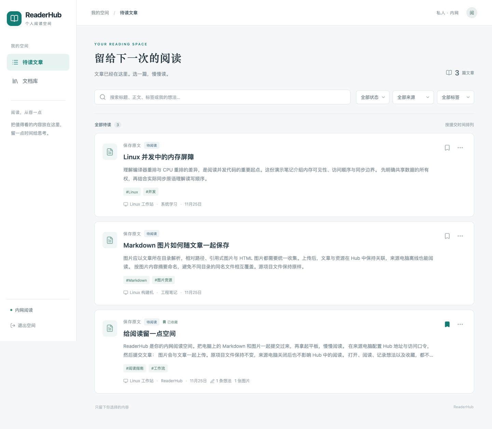
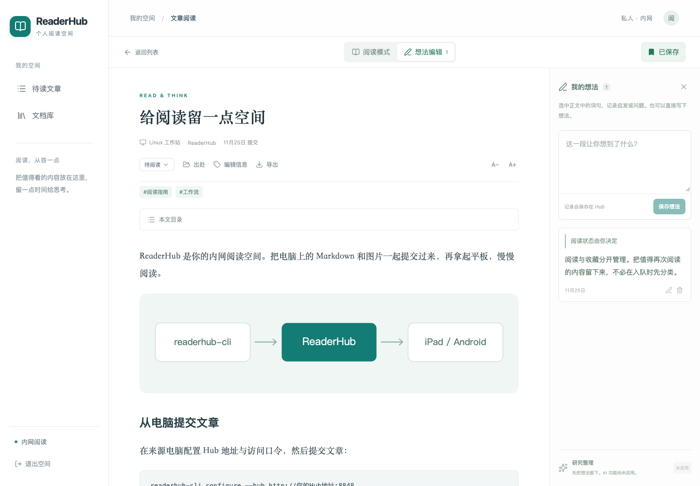

# ReaderHub

[简体中文](README.md) | **English**

ReaderHub is a system for reading, annotating, and selectively archiving documents across devices, designed for material produced during development and AI-assisted work.

Architecture notes, technical explanations, experiment records, and build reports accumulate across computers and projects. ReaderHub brings them into a shared reading workspace, where you can capture excerpts, thoughts, and questions before deciding what to remove, preserve, or investigate further as a reusable knowledge article.

The workflow is **capture material → read and think → selectively retain → research and develop knowledge**. The current release implements document intake, reading, notes, and saved articles on a local network. AI research and fully public-server deployment are planned.



> Screenshots show the current Chinese interface with demonstration articles and Linux source names. They contain no real host addresses or private reading records.

## Project approach

- **Bring in material when needed.** People, scripts, and document-producing tools can invoke the CLI without choosing archive folders or building a classification system first.
- **Keep source projects intact.** Original files and project layouts remain unchanged. The current LAN release stores submitted versions of text and images on the Hub.
- **Connect reading with thinking.** Read without distraction, select passages, and record thoughts or questions with their context.
- **Let the reader choose what stays.** Reading and saving are separate decisions. Preserve useful originals, remove material you no longer need, and manage reading status explicitly.
- **Keep knowledge portable.** Export text, images, provenance, and notes together. Planned research features will produce articles organized around knowledge points, with supporting references.

```text
Project documents / AI output / experiment and build records
                         │ submit selected material
                         ▼
               Read → excerpts, thoughts, questions
                         │
                         ├── Remove material
                         ├── Save original → library → read again
                         └── Research [planned] → new knowledge article
```

## Available now

| Stage | Implemented capabilities |
| --- | --- |
| Intake | macOS/Linux CLI uploads Markdown, collects referenced images, verifies integrity, and deduplicates submissions |
| Reading | Responsive Web interface, table of contents, image enlargement, font sizing, and reading-position tracking |
| Notes | Select passages or write freely; edit, delete, and return to the quoted passage |
| Reading status | Explicit “To read / Read” controls; opening, finishing, or saving an article does not change its status automatically |
| Selective retention | Queue and saved-library membership are independent and share the same article resources |
| Retrieval | Editable display titles and tags; search article text, provenance, and personal notes |
| Export | ZIP packages containing Markdown, images, source information, and excerpt notes |

The current release accepts `.md` and `.markdown` files and supports a single user on a local network. AI endpoints and UI remain disabled scaffolding: no search, analysis, or article generation is performed.

## Current deployment

```text
macOS / Linux source computers
          readerhub-cli
                │ HTTP upload: text and images
                ▼
     Always-on macOS · readerhub
                │ Web interface and content service
                ▼
 iPad / Android tablet / desktop browser
```

The source CLI runs on demand and exits. It requires no background daemon, device discovery, or online-status tracking. Submitted versions remain readable when the source computer goes offline or its files change.

## Quick start

The following example builds and runs the Hub on an Apple Silicon Mac. Development requires Go 1.26, Node.js 22.12+, npm, and Make; the Go toolchain is pinned in `go.mod`. Target devices do not need Go or Node.js to run the compiled programs.

### 1. Build

From the project root:

```sh
npm --prefix web ci
make build
```

Outputs are written to `dist/darwin-arm64/`. Intel Macs use `dist/darwin-amd64/`. Run `make build-all` to build macOS and Linux artifacts for amd64 and arm64.

### 2. Start the Hub

Replace the example address `192.168.1.10` with the Hub's actual LAN IP:

```sh
./dist/darwin-arm64/readerhub serve \
  --listen 192.168.1.10:8848 \
  --data "$HOME/ReaderHubData"
```

In another terminal, retrieve the access token generated on first startup:

```sh
./dist/darwin-arm64/readerhub token --data "$HOME/ReaderHubData"
```

### 3. Submit an article

Enter the Hub access token when prompted. The `--name` option sets the source's display name:

```sh
./dist/darwin-arm64/readerhub-cli configure \
  --hub http://192.168.1.10:8848 \
  --name "Workstation"

./dist/darwin-arm64/readerhub-cli add \
  ./tests/fixtures/reading/ReaderHub使用指南.md \
  --project ReaderHub
```

The CLI resolves image paths relative to the article's directory and leaves source files unchanged. See the [deployment guide](docs/deployment.md#安装来源端-cli) for installing the CLI on a Linux source computer. The included sample article is in Chinese.

### 4. Read and take notes

Open `http://192.168.1.10:8848` in a browser on the same network and enter the token. In an article, switch to the notes-editing mode to select passages, ask questions, or write thoughts directly. Save notes you want to keep, and add useful originals to the library for later reading.



## Documentation

Detailed guides are currently available in Chinese.

| Guide | Contents |
| --- | --- |
| [Deployment and maintenance](docs/deployment.md) | Build artifacts, persistent Hub service, CLI installation, upgrades, and backups |
| [User guide](docs/usage.md) | Uploads, image handling, reading status, notes, search, and export |
| [Development and testing](docs/development.md) | Local development, test commands, and code structure |
| [Architecture and API](docs/architecture.md) | Storage, image resources, HTTP interfaces, and recovery |

## Next steps

These are planned directions, not currently delivered features:

- [ ] **AI knowledge synthesis.** Let users explicitly select excerpts, thoughts, and questions for a model service or existing agent to research, verify, and synthesize into new Markdown knowledge articles with citations, saved to the library. Organize results by knowledge points rather than conversation turns, without executing code or modifying projects.
- [ ] **Complete public-server deployment.** Support a self-contained Hub on a public server using the same CLI, API, and Web workflow. Add Linux server deployment, HTTPS, user isolation, document-upload policies, and storage management, without requiring a home node to serve content.
- [ ] **PDF support.** Add PDF reading and text/image extraction, progressively unifying reading, excerpts, and subsequent synthesis.
- [ ] **Library presentation and organization.** Assist with display titles for untitled material, descriptions, and topic tags; support articles developed from multiple sources while preserving provenance.
- [ ] **Cross-platform distribution.** Add a Windows CLI and easier installation and upgrades while keeping source clients lightweight and on demand.

---

Built with Codex.
