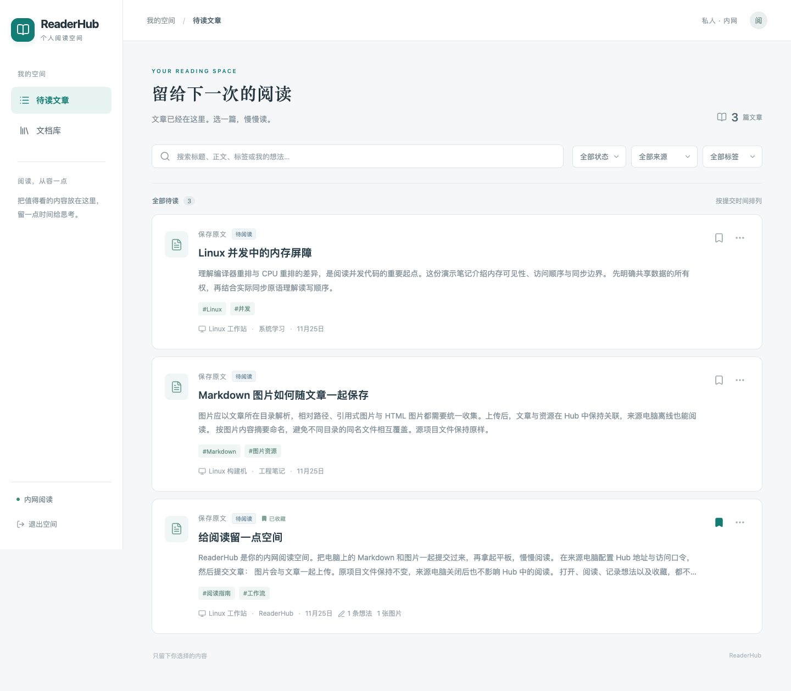
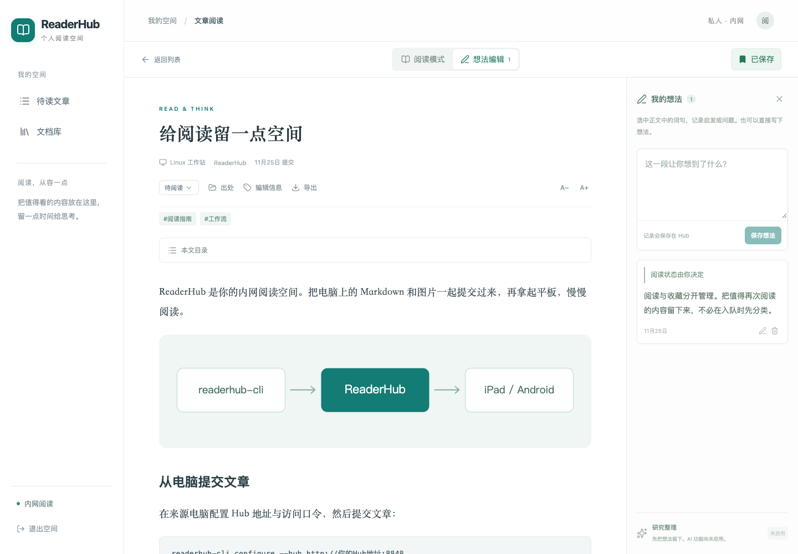

# ReaderHub

**简体中文** | [English](README.en.md)

ReaderHub 是一个面向研发与 AI 产出文档的跨设备阅读、摘记与选择性归档系统。

架构说明、技术解析、实验记录和构建报告不断产生，散落在不同电脑和项目里。ReaderHub 将这些材料接入统一的阅读入口，让你在阅读时留下摘录、想法和问题，再决定哪些可以移除、哪些值得保存，以及哪些需要进一步研究，形成可复用的知识文章。

项目围绕 **材料接入 → 阅读与思考 → 选择性保留 → 研究整理与知识沉淀** 展开。当前版本先完成内网中的图文接入、阅读、记录与收藏；AI 研究整理和完整公网部署属于后续计划。



> 截图使用演示文章和 Linux 来源名称，不包含真实主机地址或私人阅读记录。

## 项目思路

- **按需接入材料**：人、脚本或文档生产工具可调用 CLI 提交文章，不要求先决定归档目录或建立分类体系。
- **保持来源项目完整**：不移动或改写原文件，不改变项目目录。当前内网版将正文与图片的提交版本保存到 Hub。
- **阅读与思考结合**：既可以专心阅读，也可以选取词句、记录自己的想法和问题，保留对应上下文。
- **由人选择留下什么**：读过不等于收藏。保留有价值的原文，移除无需继续留存的材料，手动维护阅读状态。
- **让知识能够独立使用**：正文、图片、来源和记录可以一起导出；未来的研究整理将以知识点组织新文章，并保留资料依据。

```text
项目文档 / AI 产出 / 实验与构建记录
                  │ 按需提交
                  ▼
         阅读 → 摘录、想法与问题
                  │
                  ├── 移除材料
                  ├── 保存原文 → 文档库 → 再次阅读
                  └── 研究整理〔计划中〕→ 新的知识文章
```

## 当前能力

| 环节 | 已实现 |
| --- | --- |
| 材料接入 | macOS/Linux CLI 提交 Markdown，自动收集关联图片，校验完整性并去重 |
| 图文阅读 | 响应式 Web、文章目录、图片放大、字号调整和阅读位置记录 |
| 思考记录 | 选择词句或直接记录想法，支持编辑、删除和返回原文片段 |
| 阅读安排 | 手动管理“待阅读 / 已读”，打开、读到底或收藏均不自动改变状态 |
| 选择性保留 | 待读与收藏独立管理，共用一套文章资源，保存时不复制第二套图片 |
| 再次查找 | 可编辑的展示标题与标签，搜索正文、来源和用户记录 |
| 导出迁移 | ZIP 包含 Markdown、图片、来源信息和摘录笔记 |

当前支持 `.md`、`.markdown`，采用内网单用户模式。AI 接口和界面仅保留禁用框架，尚不执行搜索、分析或文章生成。

## 当前部署方式

```text
macOS / Linux 来源电脑
       readerhub-cli
             │ HTTP 上传正文与图片
             ▼
    常开 macOS · readerhub
             │ Web 界面与内容服务
             ▼
 iPad / 安卓平板 / 电脑浏览器
```

来源端 CLI 按需运行后退出，不需要守护进程、设备发现或在线状态维护。Hub 保存提交版本，因此来源电脑离线或文件后续变化，不影响已经提交的阅读材料。

## 快速开始

以下以 Apple Silicon Mac 构建和运行 Hub 为例。开发环境需要 Go 1.26、Node.js 22.12+、npm 和 Make；工具链版本由 `go.mod` 固定。构建后的程序不要求目标设备安装 Go 或 Node.js。

### 1. 构建

在项目根目录执行：

```sh
npm --prefix web ci
make build
```

产物位于 `dist/darwin-arm64/`。Intel Mac 对应 `dist/darwin-amd64/`。`make build-all` 可生成 macOS 与 Linux 的 amd64、arm64 产物。

### 2. 启动 Hub

将示例地址 `192.168.1.10` 换成 Hub 的实际内网 IP：

```sh
./dist/darwin-arm64/readerhub serve \
  --listen 192.168.1.10:8848 \
  --data "$HOME/ReaderHubData"
```

另开终端取得首次启动生成的访问口令：

```sh
./dist/darwin-arm64/readerhub token --data "$HOME/ReaderHubData"
```

### 3. 提交文章

配置时按提示输入 Hub 访问口令，`--name` 指定来源显示名称：

```sh
./dist/darwin-arm64/readerhub-cli configure \
  --hub http://192.168.1.10:8848 \
  --name "工作电脑"

./dist/darwin-arm64/readerhub-cli add \
  ./tests/fixtures/reading/ReaderHub使用指南.md \
  --project ReaderHub
```

CLI 以文章所在目录解析图片路径，源文件保持不变。为 Linux 来源电脑安装 CLI，见[部署文档](docs/deployment.md#安装来源端-cli)。

### 4. 阅读并记录

在同一内网的浏览器访问 `http://192.168.1.10:8848` 并输入口令。打开文章后，可以切换到“想法编辑”，选取词句、提出问题，或直接写下想法。记录值得保留时点击保存；原文值得重读时保存到文档库。



## 文档

| 文档 | 内容 |
| --- | --- |
| [部署与维护](docs/deployment.md) | 构建产物、Hub 常驻运行、CLI 安装、升级与备份 |
| [使用指南](docs/usage.md) | 上传、图片处理、阅读状态、想法、搜索与导出 |
| [开发与测试](docs/development.md) | 本地开发、测试命令和代码结构 |
| [架构与 API](docs/architecture.md) | 数据存储、图片资源、HTTP 接口与恢复机制 |

## 下一步计划

以下是后续方向，尚未作为当前功能交付：

- [ ] **AI 知识整理**：由用户主动选择摘录、想法和问题，接入模型服务或已有 agent，进行搜索、核实与归纳，生成带引用的新 Markdown 知识文章，保存到文档库。结果按知识点组织，不保留为聊天问答，不执行代码或修改项目。
- [ ] **完整公网部署**：在统一的 CLI、API 和 Web 流程下，让 Hub 可独立运行在公网服务器，补齐 Linux 服务端部署、HTTPS、用户隔离、文档上传边界和容量管理，不依赖家庭节点承担内容服务。
- [ ] **PDF 支持**：接入 PDF 阅读与文本、图片提取，逐步统一阅读、摘录和后续整理体验。
- [ ] **文档库展示与组织**：辅助完善无标题文章的展示标题、内容简介和主题标签，支持从多个来源材料组织知识文章，同时保留来源关系。
- [ ] **跨平台发布**：补充 Windows CLI 和更便捷的安装、升级方式，继续保持来源端轻量、按需运行。

---

Built with Codex.
