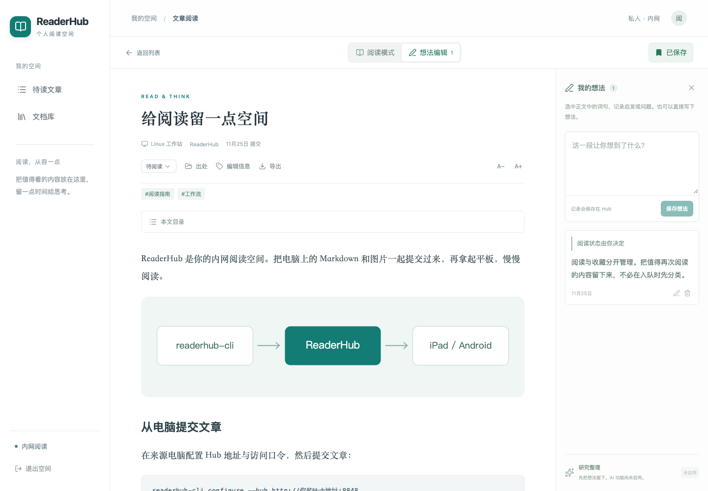

# 使用指南

## 第一次连接

先由 Hub 机主取得访问口令。在来源电脑配置地址和显示名称：

```sh
readerhub-cli configure \
  --hub http://192.168.1.10:8848 \
  --name "Linux 工作站"
```

将示例 IP 换成实际地址，并在提示后输入口令。显示名称用于列表中的来源识别，不代表设备实时在线。配置后，CLI 会沿用稳定设备标识。

## 提交文章

```sh
readerhub-cli add ./docs/design.md --project 我的项目
readerhub-cli add ./notes.md --title "更容易识别的标题"
```

一次提交一篇 `.md` 或 `.markdown`。指定 `--project` 有助于以后按来源和关键词查找；没有指定时取文章所在目录名。

CLI 会输出收集到的图片引用数量和去重后的文件数量，成功后返回包含文章 ID、阅读 URL 和重复提交标记的 JSON 回执。失败会以非零退出码结束，适合被脚本调用。

同一设备、路径、正文及图片内容再次提交时复用已有版本；修改后提交形成新版本，不覆盖之前的阅读材料。若原版本只保留在收藏中，再次提交会重新进入待读，原来的手动阅读状态保留。

## 图片怎么处理

例如项目目录为：

```text
project/
├── docs/article.md
└── images/diagram.svg
```

文章可以使用：

```markdown

```

路径以 `article.md` 所在目录解析，与运行 CLI 时的工作目录无关。图片与文章一起上传，服务端使用内容摘要命名，避免不同目录下的同名图片互相覆盖。

| 形式 | 当前行为 |
| --- | --- |
| 行内与引用式 Markdown 图片 | 解析并收集文件 |
| HTML img 的 src | 解析并收集文件 |
| 本地相对路径、绝对路径及 file URL | 在来源电脑读取，源文件不修改 |
| HTTP/HTTPS 图片 | 在提交时下载并本地保存；失败会报告 |
| data URI 图片 | 解码并纳入资源清单 |
| 代码块中的图片示例 | 保持为代码，不读取示例路径 |
| SVG | 支持自包含图形；外部依赖应先嵌入 |

当前单篇 Markdown 上限 4 MiB、单张图片 24 MiB、单次上传 64 MiB。缺图、格式不支持或超出限制时，CLI 在提交前报错，Hub 不展示不完整文章。

普通超链接不会递归上传整个项目。第一版的图片解析面向 img src，不覆盖 srcset、CSS 背景图或其他附件格式。

## 阅读与状态

在同一内网的浏览器打开 Hub 并输入口令。待读列表展示标题、正文预览、标签和来源，可以搜索标题、正文、项目及自己的记录，并按来源、标签或阅读状态筛选。

没有明确标题的文章使用已有正文段落作为临时展示标题；“编辑信息”可以改标题与标签，来源原文保持不变。正文预览只是提取原文，不进行 AI 分析。

**待阅读是你手动维护的状态。** 打开文章、读到底、写想法、收藏或导出，都不会自动变成“已读”。阅读页中的状态下拉框是明确的修改入口。

阅读页提供目录、字号调整、图片放大和继续上次位置。Hub 保存提交版本，之后来源文件变化或来源电脑离线不影响这份材料。

## 记录与编辑想法

切换到“想法编辑”模式后：

1. 选中正文中的词句，关联摘录出现在编辑区；也可以不选原文。
2. 输入想法或问题，点击“保存想法”。
3. 已保存记录可以编辑、删除，或点击摘录返回原文位置。

尚未提交的草稿只保存在当前浏览器。点击保存后的记录保存在 Hub，可在其他阅读设备打开。“阅读模式”收起编辑界面，切换模式不会删除已有记录。

“研究整理”当前保持禁用。第一版不会提交模型请求、生成研究结果或执行代码。



截图使用演示内容和虚构来源名称。

## 收藏、移除与再次查找

“保存到文档库”给当前材料增加收藏关系，不复制第二套正文和图片，也不改变阅读状态。

| 操作 | 留存结果 |
| --- | --- |
| 移出待读，仍有收藏 | 文章和记录继续保留在文档库 |
| 取消收藏，仍在待读 | 文章继续保留在待读列表 |
| 最后一个留存关系被移除 | 文章与其记录一起删除 |

文章不会因为读过或放久了自动删除。用展示标题、主题标签、项目或自己写过的话搜索，有助于再次找到它。

## 导出

阅读页点击“导出”，得到包含以下内容的 ZIP：

```text
article.md       图片地址本地化后的 Markdown
source.md        原始提交文本
metadata.json    标题、标签、版本与来源
notes.json       想法与摘录
assets/          本文图片
```

解压后使用普通 Markdown 工具打开 `article.md`，图片通过相对路径显示。导出包含来源与个人记录，分享前可以选择需要保留的内容。

## 脚本调用与环境变量

| 环境变量 | 用途 |
| --- | --- |
| READERHUB_URL | add 命令使用的 Hub 地址，命令行 --hub 优先 |
| READERHUB_TOKEN | 为 configure/add 提供访问口令，优先于已有配置 |
| READERHUB_CLI_CONFIG | 指定 CLI 配置位置，便于隔离脚本与测试环境 |

`configure` 的 Hub 地址使用 `--hub` 指定或沿用已有配置；`READERHUB_URL` 不替代 configure 的该参数。不要把真实口令、来源文件或完整运行配置提交到源码仓库。
