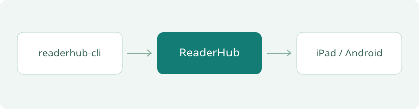

# 给阅读留一点空间

ReaderHub 是你的内网阅读空间。把电脑上的 Markdown 和图片一起提交过来，再拿起平板，慢慢阅读。



## 从电脑提交文章

在来源电脑配置 Hub 地址与访问口令，然后提交文章：

```sh
readerhub-cli configure --hub http://你的Hub地址:8848
readerhub-cli add ./article.md --project 我的项目
```

图片会与文章一起上传。原项目文件保持不变，来源电脑关闭后也不影响 Hub 中的阅读。

## 阅读状态由你决定

打开、阅读、记录想法以及收藏，都不会自动改变“待阅读”。想调整时，在阅读页手动选择“已读”或“待阅读”。

## 留下你的想法

切换到**想法编辑**，选择正文中的词句，写下启发或问题并点击“保存想法”。也可以不引用原文，直接记录。草稿留在当前设备；点击保存后的记录存放在 Hub。

## 保存值得重读的内容

点击“保存到文档库”，以后可以通过标题、正文、标签和自己的记录找回文章。移出待读列表不会删除已有收藏。

| 操作 | 结果 |
| --- | --- |
| 阅读 | 保留原来的手动阅读状态 |
| 保存到文档库 | 保留文章和图片，不重复拷贝一份全文 |
| 编辑标题与标签 | 只修改 Hub 展示信息，不修改源文件 |

## 关于研究整理

第一版保留研究整理入口，但 **AI 尚未启用**，不会调用模型或执行任何分析。你可以先把想法记录下来。
